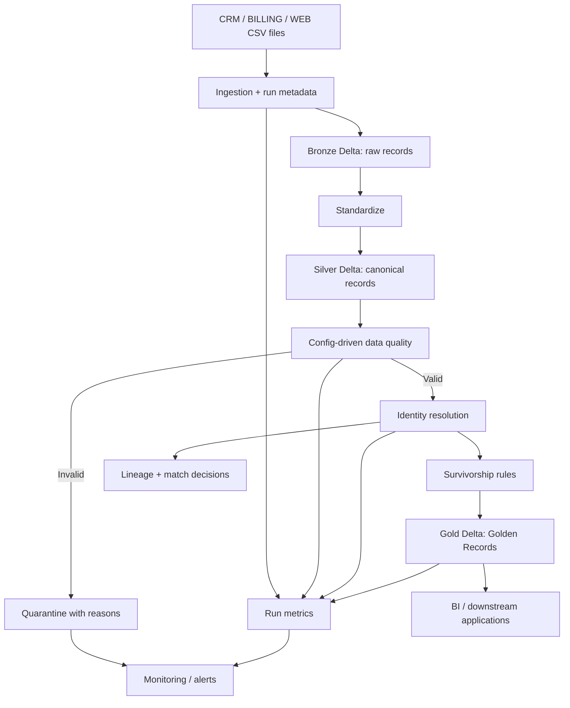

# Enterprise MDM Platform — An Explainable Reference Project

A small, understandable PySpark + Delta Lake implementation of the assignment: ingest multi-source customer data, standardize it, validate quality, identify duplicates, create Golden Records, preserve lineage, reconcile counts, and expose operational metrics.

> **Important:** This is a learning/demo repository, not a production MDM engine. The matching strategy is intentionally transparent. Before production use, validate identity rules against labelled data and persist cluster membership across runs.

## 1. Explain the project in one minute

Three source systems (CRM, BILLING, WEB) send customer records. Their data may contain different casing, whitespace, duplicate people, missing names, invalid emails, and conflicting addresses.

The pipeline follows five steps:
1. **Bronze:** preserve raw records and source metadata.
2. **Silver:** standardize values and run configurable quality rules.
3. **Identity resolution:** link records with the same normalized email or phone.
4. **Gold:** select the best attribute values using configurable source precedence and latest update.
5. **Operations:** save rejected rows, lineage, match decisions, and reconciliation counts.

## 2. Architecture



## 3. Repository structure

```text
config/
  quality_rules.json       # Add/change quality rules without changing pipeline code
  survivorship.json        # Source priority per attribute
data/
  customers.csv            # Synthetic records from three source systems
docs/
  architecture.md          # Design, trade-offs, scalability, security
  data_model.sql           # Logical tables for a production implementation
src/mdm/
  pipeline.py              # Small, modular PySpark implementation
  generate_data.py         # Regenerate sample data
tests/
  test_rules.py            # Tests for configuration files
requirements.txt
```

## 4. Run it

Requirements: Python 3.10+, compatible Java, and PySpark 3.5+.

```bash
python -m venv .venv
# Windows: .venv\Scripts\activate
# macOS/Linux: source .venv/bin/activate
pip install -r requirements.txt
python -m src.mdm.generate_data
pytest -q
```

Run with Spark available:

```bash
spark-submit src/mdm/pipeline.py \
  --input data/customers.csv \
  --output output \
  --rules config/quality_rules.json \
  --survivorship config/survivorship.json
```

On Azure Databricks, use an ADLS Gen2 path such as `abfss://container@account.dfs.core.windows.net/customers/` for input/output and configure access with Unity Catalog external locations and managed identity/service principal. Never hard-code credentials. The demo writes Delta format outputs.

## 5. Outputs

- `bronze/` — raw source rows plus run/source metadata
- `silver/` — standardized canonical rows
- `valid/` — rows passing ERROR-level quality rules
- `quarantine/` — invalid rows with reason codes
- `golden/` — one Golden Record per matched identity cluster
- `lineage/` — source record to Golden Record mapping and match rule
- `quality_results/` — one row per evaluated rule and source record
- `metrics/` — source, valid, rejected, duplicate, and Golden Record counts

## 6. Simple design decisions

### Ingestion and schema evolution
The demo reads CSV and adds `run_id`, `source_file`, and `ingested_at`. It checks required columns and fails clearly if the input contract is broken. The architecture can support JSON, JDBC, APIs, and streams through separate source adapters. For a new optional field, update the canonical schema and review the change before enabling Delta `mergeSchema`; do not blindly accept arbitrary schema changes.

### Standardization
Trim names, lowercase emails, strip non-digits from phone numbers, uppercase country codes, and parse timestamps. Real phone normalization should use country-aware logic.

### Quality rules
JSON configuration defines required fields, email format, and allowed country codes. `ERROR` rules quarantine records; `WARN` rules are reported but do not reject the record. Add supported rule types in code only when introducing a new type of validation; new values or rules of existing types can be added in JSON.

### Identity resolution
The demo matches exact normalized email or phone. It records a match reason. This is deterministic and easy to explain, but can produce false positives for shared phone numbers or bad emails. A production system should use blocking, pair scoring, thresholds calibrated on labelled examples, and a manual-review queue for uncertain matches.

### Survivorship
Each attribute has its own source precedence. Among records in a cluster, choose a non-empty value from the highest-priority source; use the latest update and source record ID as tie-breakers. This is called **attribute-level survivorship**.

### Lineage and reconciliation
Every source record keeps `source_system` and `source_record_id`. Lineage links these identifiers to a `golden_id`. Counts are captured at each stage. Investigate differences by checking quarantined records, duplicate clusters, source file/run IDs, and match decisions.

### Observability and recovery
A real deployment should log `run_id`, stage, duration, counts, and exception details; alert on failed jobs, abnormal reject rates, late files, or count variances; retry transient errors; and quarantine deterministic bad records. Use Databricks Workflows for scheduling and notifications.

## 7. Scale, security, and production evolution

For tens of millions of records:
- Use Spark-native DataFrame operations and Delta tables; avoid collecting data to the driver.
- Generate candidate matches with blocking keys rather than comparing every pair.
- Use incremental/CDC ingestion and Delta `MERGE` with idempotent keys.
- Monitor Spark UI for shuffle, skew, spill, slow tasks, and small files.
- Partition only on useful low/medium-cardinality filters; compact files when beneficial.
- Apply Unity Catalog permissions, managed identity, encryption, masking, retention, and access audits.
- Persist Golden ID mappings across runs; the demo derives IDs for demonstration and does not provide long-term cluster identity management.
- Add CI, data contracts, schema registry, streaming checkpoints, and a serving API as future enhancements.

## 8. GitHub publishing

Create an empty repository in GitHub, extract this folder, and run:

```bash
git init
git add .
git commit -m "Add explainable enterprise MDM pipeline"
git branch -M main
git remote add origin <YOUR_REPOSITORY_URL>
git push -u origin main
```

Replace `<YOUR_REPOSITORY_URL>` with your repository URL. I can prepare the repository files here, but I cannot publish to your GitHub account directly from this chat.
